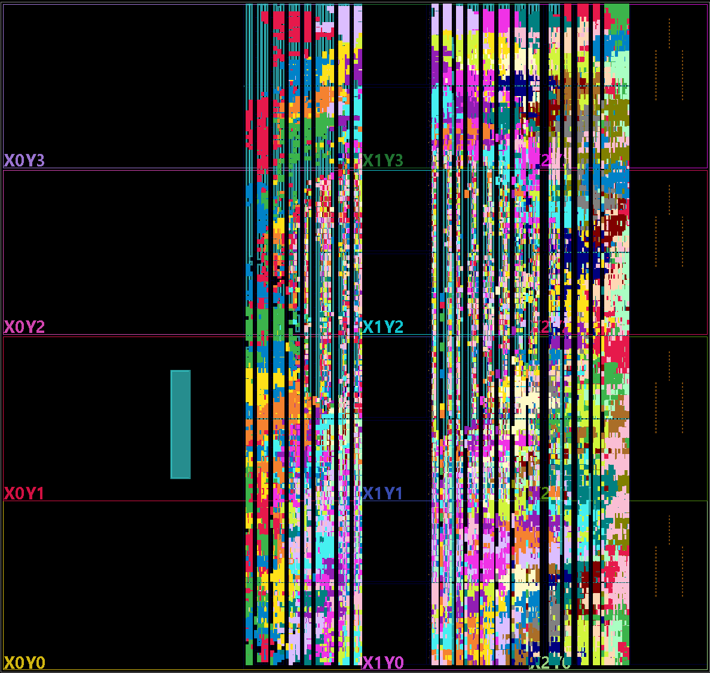
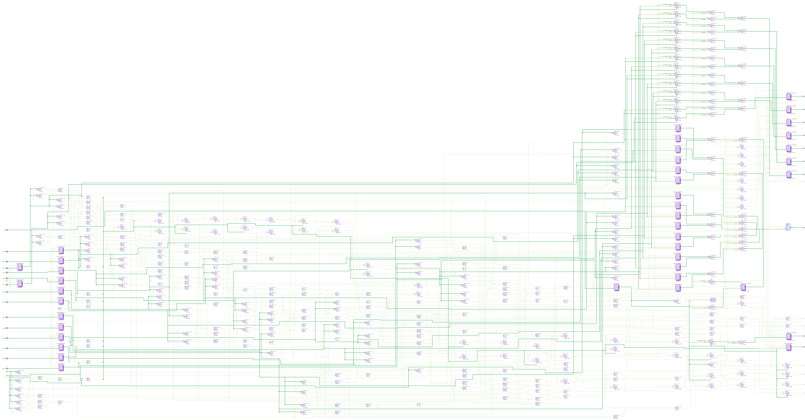
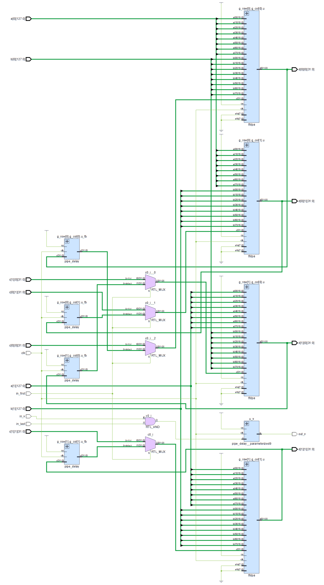
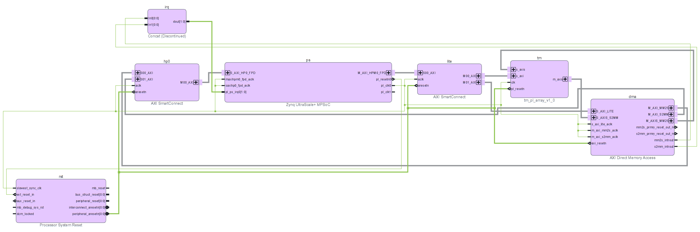

# tensor-mirror

Bit-exact replicas of GPU tensor-core arithmetic, in hardware.

GPU matrix units do not compute `D = A·B + C` the IEEE way. They align the products at the
largest exponent, truncate them to a fixed number of fractional bits, sum in fixed point and
round once, with parameters that change from one generation to the next. Bit-accurate
software models of that behaviour exist, notably [MMA-Sim](https://github.com/microsoft/MMA-Sim)
([arXiv 2511.10909](https://arxiv.org/abs/2511.10909)). tensor-mirror takes them to RTL: one
parametrisable unit for an FPGA (AMD Kria KV260) that returns the same bits as a chosen
NVIDIA GPU, from Volta to RTX Blackwell, including MXFP4/NVFP4 block scaling.

## Status

- **Integer model** (`python/tensormirror/`): T-FDPA, ST-FDPA and GST-FDPA (block scaling)
  with integer arithmetic only, written the way the datapath is built.
  - `measured=False` gives the published parameters. It equals MMA-Sim on random bit
    patterns in every T-FDPA `mma.sync` MMA-Sim models: 130 instructions in v2.1.1
    (`results/xcheck/`).
  - `measured=True` (the default) applies what we measured on real GPUs.
- **Checked against real GPUs** with our own `mma.sync` kernels (`gpu/`, `results/gpu/`):
  - **Volta:** four V100;
  - **Turing:** an RTX 2060 and an RTX 2060 Super;
  - **Ampere:** an A100;
  - **RTX Blackwell:** an RTX 5070 Ti, with `kind::f8f6f4` and the `block_scale` forms.
  - Every random and directed case matches the measured model.
- **What we measured that differs from the published models**:
  - **Turing:** it runs Volta's `m8n8k4` with Volta's 23-bit sum (F = 23), not its own 24.
  - **`e_zero`, the exponent a zero accumulator takes, depends on D's type:**
    - Volta: −19 with D in f16;
    - Turing and Ampere: −20 with D in f16 (it was −21).
  - **`kind::f8f6f4` reads an E2M1 byte as E2M3:** bits 1:0 are extra mantissa bits, not
    padding.
  - MMA-Sim adopted the first two in v2.1.0 and v2.1.1.
- **RTL** (`rtl/`, verified with Verilator against the model, with mutants):
  - **`tfdpa.sv`:** generic T-FDPA, with an optional per-block scale (ST-FDPA);
  - **`gst_fdpa.sv`:** MXFP4/NVFP4 group scaling;
  - both are pipelined and meet 250 MHz out of context in every configuration from Volta to
    RTX Blackwell (`results/fpga/ooc-*`).
- **On the KV260** (`rtl/tm_pl_x.v`, `fpga/build_kv260.tcl`):
  - **what runs:** one unit behind an AXI DMA at 214.29 MHz;
  - **result:** 0 mismatches with the GPUs in 7.6 million results of 13 instructions
    (`results/fpga/kv260-board-2026-10-22/`):
    - A100 f16, bf16 and TF32;
    - RTX 5070 Ti FP8, MXFP8 E4M3, MXFP4 and NVFP4;
    - instructions whose K spans several groups, computed in two passes.
- **GEMM arrays on the KV260** (`rtl/tm_array.sv`, `rtl/tm_pl_array.v`):
  - **what they are:** an output-stationary array of R × C T-FDPA units, each with Q = 16
    accumulators in flight. A, B and C sit in on-chip banks, and K is chained in order through
    D's format, as a loop of `mma.sync` does on the GPU.
  - **result:** 0 mismatches with the D of a `mma.sync` GEMM loop on an A100 and an RTX
    2060 Super, in all 2.36 million elements over both sizes and both types
    (`results/gpu/h029-*`, `h033-*`):
    - Ampere f16 and f32 accumulation;
    - 96 jobs per type;
    - in Verilator, with random backpressure, and on the board.
  - **4 × 4** (16 units, jobs of 64 × 64 × 256): it meets 214.29 MHz with about 48,000 LUT,
    and runs at 34 GFLOP/s (f16) and 32 (f32) on the board.
  - **8 × 4** (32 units, jobs of 128 × 64 × 256): it takes 88,562 LUT (76 %), runs at
    187.5 MHz, and gives 48 and 43 GFLOP/s on the board.
  - **Double buffered** (H-034): the next job loads, and the last one drains, while the
    array computes.
    - **Verilator:** a job drops from 11,028–14,356 cycles to 8,238–8,273, so the array
      computes 99 % of the time. D stays exact.
    - **Cost:** no BRAM or DSP, because A and B fit a second job in the same BRAMs. The C/D
      LUTRAM doubles, which takes 3,300–13,100 LUT.
    - **Timing:** 4 × 4 f16 still meets 214.29 MHz, and every build meets 187.5 MHz.
    - **On the board:** not yet run, so its throughput is still a prediction.
  - **RTX Blackwell, with the instruction's k as a parameter** (H-035): the GEMM loop can
    use an instruction shorter than the unit, such as `m16n8k8` in f16 (L = 16) or
    `m16n8k16` in FP8 (L = 32). Each instruction is then a partial group, rounded into D.
    Changing k changes D in 9–93 % of the elements, so the array takes KI and pads the
    group with zeros (`results/gpu/h035-gemm-159f42a/`):
    - **the GPU:** an RTX 5070 Ti gives the model's D in 8 loops, 3.1 million elements;
    - **the RTL:** a 4 × 4 f16 array and a 2 × 4 FP8 array give that D in Verilator, with
      KI = k. With KI = L against the k < L loop, they fail;
    - **the builds:** both close at 187.5 MHz: 65,707 LUT for the f16 array and 49,347 for
      FP8, which uses no DSP.
    - **a 4 × 4 FP8 array** (H-036) gives the same D in Verilator, and closes at 187.5 MHz
      with 81,743 LUT and no DSP.
  - **Block-scaled GEMM, MXFP4 and NVFP4** (H-037): a 4 × 4 array of `gst_fdpa.sv` units,
    with the scale factors in their own beats (`tools/bs_gemm.py`):
    - **the GPU:** the 5070 Ti's loops of 4 `m16n8k64` block-scale `mma.sync` per tile match
      the chained model, in 786,432 elements;
    - **the RTL:** the array gives their D byte for byte in Verilator;
    - **the build:** the MXFP4 one closes at 187.5 MHz with 58,460 LUT and 64 DSP
      (`results/gpu/h037-bs-gemm-97952fe/`, `results/fpga/kv260-h037/`).

Next: the board runs of the double-buffered, RTX Blackwell and block-scaled arrays.

## Pictures

From Vivado 2026.1 (`fpga/render_schematic.tcl`, `fpga/render_device.tcl`).

**The 8 × 4 array, routed on the XCK26.** This is the double-buffered f16 build, at 83 %
of the LUTs. Each of its 32 units has its own colour, and the rest of the logic is left dark:
the banks, the control and the DMA. The teal block on the left is the PS, which is hard
silicon.

<p align="center"></p>

**One unit, elaborated.** This is `rtl/tfdpa.sv` as an Ampere f16 unit (L = 8, F = 24),
with pipelined trees, before synthesis:

- the products of the 8 term pairs;
- the maximum exponent;
- the alignment and truncation to F bits;
- the fixed-point sum;
- the normalisation and the single rounding.

[](media/tfdpa_unit.png)

**A 2 × 2 `tm_array`, elaborated.** Row r's A and column c's B are broadcast to the units. A
multiplexer per unit picks C, at the start of a chain, or the unit's own D fed back. The
`pipe_delay` in that loop stretches it to Q cycles, so each unit keeps Q chains in flight.

<p align="center"></p>

**The KV260 system:** the PS, an AXI DMA for the operands and results, AXI4-Lite for the
registers, and `tm_pl_array`.



## Layout

| Path | What |
|---|---|
| `python/tensormirror/` | Formats, T-FDPA, block scaling, parameters per architecture |
| `gpu/` | `mma.sync` harnesses on raw bits (one instruction, or a loop of them per tile), block scale, throughput |
| `tools/` | Case generators and checks (`gpu_cases.py`, `bs_cases.py`), probes, MMA-Sim cross-checks, RTL vector writers, run scripts per experiment |
| `rtl/`, `tb/` | SystemVerilog/Verilog units and the PL top; Verilator testbenches |
| `fpga/` | Out-of-context synthesis, the KV260 system build, timing at the board's clock rates |
| `results/` | Evidence for every number: GPU runs, cross-checks, RTL runs, synthesis and board runs, each with a README |
| `media/` | The pictures in this README |

The hashes in `results/` names and READMEs are those of the commits the evidence came from,
before this repository's history was rewritten to publish it. The trees are unchanged.

## Running

```sh
python -m venv .venv && .venv/bin/pip install -e .[test]
.venv/bin/pytest
```

The MMA-Sim comparison needs `pip install -e .[mmasim]` on Linux. MMA-Sim builds a C++
extension at import time, with `ninja` on the PATH.

```sh
python tools/xcheck_mmasim.py --arch Volta --inst m8n8k4.f32.f16.f16.f32 --cases 1000000
python tools/xcheck_mmasim.py --all --measured     # the measured model, every instruction
```

GPU runs: `tools/gpu_cases.py gen`, then the harness on the GPU host
(`tools/gpu_batch.sh run`), then `tools/gpu_cases.py check`. RTL: Verilator 5
(`tools/run_rtl_generic.sh`, `tools/run_pl_x.sh`). FPGA: Vivado 2026.1.

GEMM arrays: `tools/gemm_cases.py gen` writes jobs, the GPU computes them as a loop of
`mma.sync` (`tools/run_h029_gpu.sh`), `gemm_cases.py rtl` packs them, and
`tools/run_array.sh` runs the array and its mutants in Verilator. On the board,
`tools/kv260/tm_run.py`.

## Related work

- **MMA-Sim:** bit-accurate software models of 10 architectures. It is our reference.
- **Khattak and Mikaitis** ([arXiv 2512.07004](https://arxiv.org/abs/2512.07004)): models of
  V100, A100, H100 and B200.
- **[ucb-bar/nvfp4](https://github.com/ucb-bar/nvfp4):** an NVFP4 tensor core on an
  Artix-7, compared with an RTX 5090.
- **Ten-Four** ([arXiv 2512.00053](https://arxiv.org/abs/2512.00053)): an open-source fused
  dot-product unit in SystemVerilog for the Vortex GPGPU's tensor cores, on an Alveo U55C. It
  reports bit-exact agreement with an NVIDIA Ada GPU in FP and integer formats.
- **[arXiv 2606.00279](https://arxiv.org/abs/2606.00279):** a software emulator of the
  tensor-core block FMA for bit-exact inference, with profiles from Ampere to Blackwell.

tensor-mirror differs from these in four ways:

- one parametrised RTL unit covers every generation from Volta to RTX Blackwell;
- the units scale into GEMM arrays;
- the parameters are checked against real GPUs of four generations: Volta, Turing, Ampere
  and RTX Blackwell. Hopper, Ada and B200 keep MMA-Sim's published values, unmeasured;
- where the hardware disagreed with the published models, it says so, as listed above.

## Licence

Apache License 2.0, see [`LICENSE`](LICENSE). MMA-Sim, used as a test dependency, is MIT.
